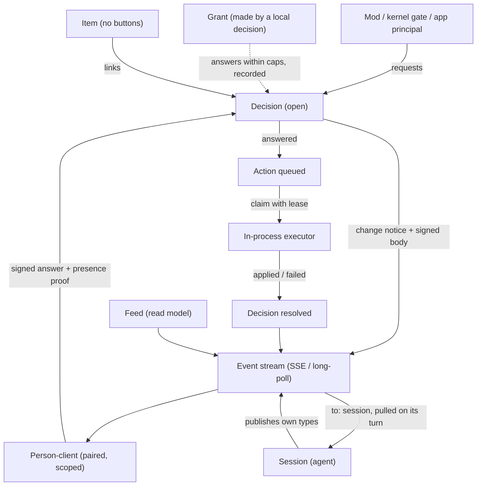

# Hitch: open client standard and the plan to make Haystack headless (draft)

Draft written 2026-11-23. Repo: **claude-extended-v2 @ `af4edeac`**, which is unreleased. `main` is at R0. Nothing was changed, started or fetched.

## TL;DR

- **Recommended spine: Hitch's resource API, built the Hitch way on v2's existing parts**, with Switchyard's safety pieces added. It is a small REST face: `decisions`, `items`, `sessions`, `messages`, `feeds`, `clients`. Changes arrive as notices over **one SSE stream, with long-poll as an equal fallback**.
- **Haystack becomes headless.** It types nothing into chats and opens no dialogs. Its Dashboard, menu bar, LAN pages and banners are retired. A **minimal reference client** proves the protocol.
- **Only a paired client acting for the person can answer a decision.** Mod, agent, session and hub tokens get `not_a_client`. With no client connected, **the decision waits for ever**. Expiry can only mean *withdrawn*, never *approved*.
- **Biggest fix over all three designs: `local` and `confirm` tiers need user presence** (Touch ID, a passkey or Windows Hello) on every answer, including from a CLI. Being on loopback is not enough, because every agent's Bash is on loopback too. First-client bootstrap is an **OS dialog that defaults to Cancel**, never a code in a file or on stdin.
- **Two signature suites.** `hmac` (Python stdlib, so pairview can join) is **capped at `decide`**. `p256` with hardware keys is needed for confirm and local.
- **R1 line:** before R1 ship the quiet front, the decision store, the answer route, pairing and the reference client. After R1: headless mod executors, the menu bar and LAN retirement, the hub relay, and envelope convergence (that last one is gated on H9).

## Name

Unchecked for trademark or package collisions; nothing was fetched.

| Name | Why |
|---|---|
| **Hitch** ✅ chosen by Tyler (2026-11-24) | Short and good on a CLI (`hitch ls`). It sits in the hay and herd theme beside Haystack and Herdquarters. |
| Patchbay | The draft's first pick: "connect many things to one backend", with no farm pun. |
| Switchyard | Good "routing" image, but long, and it suggests the event-log design. |
| Gatepost | Leads with decisions and gates, but undersells events and sessions. |
| Crossbar | Neutral and technical. Some router and WAMP projects already use the word. |
| Tether | Short. It suggests a phone link rather than a backend standard. |
| Trellis | Neutral and soft, but says nothing about what it does. |

Spec string **`hitch/1`**. It is versioned apart from `cx/1` (the mod contract) and `hub/1` (the hub link).

## Principles

| # | Principle | Rule |
|---|---|---|
| 1 | **Headless** | An implementation serves data and decisions. It has no UI of its own. |
| 2 | **Never prompts** | Nothing is typed into a session (no `signal()`, `$.ui.ask` or standup). Agents pull their `to:{session}` events on their own turn. The only exception is an answer the person explicitly chose for a session question. |
| 3 | **Only a person-client decides** | Sends, merges, deploys, sign-ins and grants are answered only by a paired person-client at or above the option's tier. |
| 4 | **Waits when no client** | A decision stays open. No default, no auto-approve, no timeout into approve. |
| 5 | **Open and versioned** | Published JSON Schemas for every type, `owner.name@major` types, additive-only changes within a major, profiles, and a conformance kit. |
| 6 | **Identity from the credential** | `from.principal`, `client` and `aid` are stamped by the server and never read from the body. This closes pairview P1 and P3 and matches herdr rule 20. |

## Model

| Object | What it is | Built from (v2) |
|---|---|---|
| **Decision** | The only way consent enters. It has a bound hash, options with tiers, a state and an audit trail. | Inbox items with actions, plus every gate: `tickets.mjs`, sendgate, pair decide, registry approve, schedule approve, settings confirm, notifiers, watch merge and approve-run, agents policy, queue waits |
| **Item** | Attention with no buttons (a failed job, red CI, a To-do). It links to its decisions. | `POST /v1/inbox` feeds, with the 15-minute TTL replaced by an explicit state |
| **Action** | Running an answered option: queued, claimed (with a lease), applied or failed. | `state.actions`, `/v1/actions/{poll,claim,done}` |
| **Feed** | A named, versioned read model (`wins.weekly@1`, `herdr-teams.org@1`). | `kernel/feeds.mjs` |
| **Session** | An agent session. It can publish and be addressed, and **never answers**. | `/v1/session`, `kernel.sessions@1` |
| **Message** | Mail between agents, and from the person to an agent, with delivery states. | parley, hub, herdr mail states, pairview v:2 |
| **Client** | A paired device or app with scopes. | pairing.mjs, menubar.mjs and LAN sessions, merged |
| **Grant** | A standing delegation created by a decision, with scope, TTL and caps. | herdr approver grants, pairview `da<N>`, approveSave |



## Envelope and types

```jsonc
// hitch/1. Used for every stream event, message and answer.
// Resource bodies from GET are plain JSON with the same fields.
{
  "spec": "hitch/1",                // major only; unknown fields are ignored
  "id": "01JD7Y3Q8K2M4N5P6R7S8T9V0W",  // ULID, globally unique
  "seq": 48213,                        // per-node cursor = SSE id = Last-Event-ID (today's bus id)
  "time": "2026-11-24T14:03:11.402Z",
  "type": "hitch.changed@1",        // owner.name[.sub]@major; kernel/bus.mjs TOPIC grammar
  "subject": "decision/dec_01JD…",     // what this is about
  "from": {                            // ALL stamped by the node from the credential
    "aid": "k3v9q2m7x1ab",             // proto/aid.ts
    "member": "m-office-manager",      // the client's or org's own id; opaque, never used for auth
    "principal": "client:c_7fk2",      // node | mod:<id> | app:<id> | session:<sid> | client:<cid> | grant:<gid> | peer:<aid>
    "login": "tyevco", "device": "mbp" // only when hub- or pairing-stamped
  },
  "to": { "session": "s-…" },          // {session}|{aid}|{member}|{group,role:"lead"}|{person}|{connector:"teams#chan"}|{client}
  "replyTo": "01JD7Y…",
  "trace": "t-9c1e…",                  // x-cx-trace; hops are computed by the receiver
  "idem": "outbox:draft:42:v3",        // optional idempotency key (pairview origin_id, hub op ids)
  "privacy": "meta",                   // public | counts | meta | text | secret. Set by the NODE from the type's schema, not by the publisher
  "data": { },                         // types/<owner>.<name>@<major>.schema.json; ≤ 8 KB
  "ref": { "content": "sha256:9a1c…", "bytes": 21430 }, // large bodies: GET /hitch/v1/content/:hash (erasable)
  "sig": { "suite": "ed25519", "kid": "node:k3v9…", "v": "…" } // the node signs what it emits; clients verify against the key pinned at pairing
}
```

**Initial catalogue.** Floors are the minimum tier. A mod can raise a tier, never lower it.

| Type | Owner | Data sketch | Floor |
|---|---|---|---|
| `hitch.changed@1` | hitch | `{resource, id, rev, op, state?}`, public | — |
| `hitch.gap@1` / `hitch.beat@1` | hitch | `{from,to}` / `{head}` | — |
| `hitch.attention.due@1` | hitch | `{ids, level, reason:new\|ladder\|batch}` (the node runs `notifier.plan`) | — |
| `hitch.presence@1` | hitch | `{client, here\|away\|locked, until}` | — |
| `hitch.decision@1` | hitch | see Decisions | — |
| `hitch.answer@1` | hitch | `{decisionId, aid, verb, rev, bindHash, shownHash, text?, iat, exp, nonce, presence?}` | — |
| `hitch.client.pair@1` | hitch | decision: SAS, name, scopes | **local** |
| `hitch.client.scope@1` | hitch | decision: raise a client's scope | **local** |
| `hitch.grant.issue@1` | hitch | decision: `{kinds[], scope, ttl, caps}`; **safety kinds forbidden** | **local** |
| `hitch.question@1` | hitch | a session question; may be `defaultable` (requester fallback). **Not consent.** | decide |
| `kernel.session.started/status/ended@1` | kernel | `{sid, aid, member?, project, status, doing}` | — |
| `kernel.job.approve@1` | kernel | decision bound to the prompt hash | confirm |
| `kernel.mod.admit@1` | kernel | decision (replaces "approve herdr-teams on the Dashboard") | local |
| `kernel.settings.confirm@1` / `kernel.permissions.mode@1` | kernel | hash-bound | local |
| `kernel.connector.signin@1` / `kernel.lan.access@1` | kernel | | local |
| `kernel.hub.release@1` | kernel | staged hub send (sendgate) | confirm |
| `kernel.agents.grant@1` | kernel | expose, grant, extend, quarantine | local |
| `watch.merge@1` / `watch.deploy@1` / `watch.prready@1` | watch | PR or run ref | confirm |
| `outbox.send@1` | outbox | draft `ref`, recipient resolved by the node | confirm |
| `parley.send@1` / `parley.room.post@1` | parley | | decide (confirm if `reachesOut`) |
| `director.hire@1` | director | | confirm |
| `playbook.entry@1` | playbook | keep / keepRepo / edit / discard, bound to the content hash | decide |
| `forms.submit@1` / `report.send@1` | forms / report | | decide / confirm |
| `queue.question@1` / `queue.permission@1` / `queue.plan@1` | queue | choices; permit-once or deny only | confirm (deny is narrow) |
| `wins.confirm@1` / `wins.stage@1`; feeds `wins.weekly@1`, `wins.report@1` | wins | | decide |
| `message.received/answered/delivery@1`, `work.*@1`, `todo.*@1` | generic | from contract.mjs GENERIC_TOPICS; `delivery.state` is queued\|sent\|seen\|acked\|held\|failed\|expired\|disputed | — |
| `herdr-teams.hire/layoff/leave/return/station/run/escalation@1` | herdr-teams | preview rows plus rule-42 hashes as the bind | vendor-declared, see Auth |
| `pairview.spawn@1`, `pairview.rule@1` | pairview | optional | vendor-declared |

**Retired types:** `<mod>.signal@1` as a way to prompt (ledger rows stay as audit), the sweep and standup topics, and `/hookwait` waits (they become `queue.*`).

## Decisions

**Shape** (generic fields any client can render):

```jsonc
{ "id":"dec_01JD…", "kind":"outbox.send@1", "rev":7, "state":"open",
  "owner":"outbox", "requester":{"principal":"mod:outbox","session":"s-…","member":"…"},
  "title":"…", "summary":"…",          // mod-supplied: shown QUOTED, under the owner label
  "effect":"Sends a Teams message to Dana Whitfield as you", // NODE-derived from kind + bound args
  "preview":[{"label":"To","value":"…"},{"label":"Body","digest":"sha256:…","ref":"sha256:…"}],
  "bind":{"alg":"sha256/v1","hash":"…"}, "safety":"send",   // send|merge|deploy|signin|grant|none
  "audience":"person",                  // or {member:"m-lead"} for herdr escalations below the top
  "options":[{"verb":"approve","label":"Send","tier":"confirm","allowedForYou":false},
             {"verb":"sendBack","tier":"decide","needsText":true,"maxText":2000},
             {"verb":"decline","tier":"narrow"}],
  "remoteApprove":false, "urgency":"normal", "expires":null, "onExpire":"withdraw" }
```

**End to end:**

| Step | What happens | Grounded in |
|---|---|---|
| 1. Request | A mod, kernel gate or **app principal** asks. The node checks the declared kind, computes the **bind hash itself** (for herdr-teams it accepts the requester's rule-42 hash as the bind, because the runner re-verifies it), derives `effect`, sets privacy from the schema, applies rate limits and an open-decision cap per requester, then signs and stores. | sendbind, drawn/shown/seen, rule 42 |
| 2. Present | `hitch.changed@1`, then the client GETs the signed body. The client verifies the node signature **before rendering**. | Switchyard node signing |
| 3. Change | Content edited: `rev`++ and a new bind. Answers against the old one get `stale`. | today's `sig` |
| 4. Answer | `POST /hitch/v1/decisions/:id/answers` carries `{verb, rev, bindHash, shownHash, aid, iat, exp≤120s, nonce, presence?}`. `shownHash` is the hash of the exact title, effect and preview the client rendered, so a relay cannot relabel a decision. `aid` stops a replay to another of Tyler's nodes. | herdr-intent/v1 |
| 5. Checks, in order | person-client or grant → not revoked → verb offered → option tier ≤ client ceiling, after the transport clamp → kind allow-list or `remoteApprove` → presence proof for confirm and local → rev, bind and shown hash current → open (CAS) → nonce fresh, iat/exp. | `webAction` + `lan/tiers.mjs` gate, one funnel |
| 6. Execute | `action.queued`. Args stay server-side. An **in-process executor** (or one holding a kernel-minted executor credential, **never a hello token**) claims with a lease and **re-checks the bind at claim** for every kind. Sends still get their ticket only in the claim answer. Queue answers re-check the visible pane against the bind **at keypress time**. | tickets.mjs, paneanswer.mjs |
| 7. Resolve | Outcomes: `applied`, `failed`, `declined`, `sent-back`, `withdrawn`, `expired`, `resolved-elsewhere{by, where}`, `fallback` (questions only). A failure never retries into a new outcome without a new decision. | Switchyard outcomes |

**Multiple clients.** All see the same record. The first valid answer wins by CAS on `rev`. The others get `already` plus the winner, and must show "answered on <device>". Later and snooze are **client-local**. The node keeps no `inboxDismissed`.

**Answered in an authoritative vendor client.** Tyler approves on Herdquarters' Pending shelf, which writes teams.json. herdr-teams (as an app principal) resolves the decision as **`resolved-elsewhere{by:"human", where:"herdr"}`**. It is not shown as withdrawn, and a phone answer that loses the race gets `already`.

**No client connected.** The decision stays open. The node runs the attention ladder (pure `notifier.plan`: quiet hours, high kinds, batching, away hold) and emits `attention.due@1`. Push sends **counts and kinds only**. The requesting agent sees only `pending` when it reads; nothing is typed into its chat.

**Expiry.** Optional, declared per kind. It resolves only to `expired` or `withdrawn`. **Safety kinds may not declare a default.** `hitch.question@1` may set `defaultable` (pairview `ask_default`), recorded as `fallback`. The node refuses that for safety kinds.

**Grants.** A grant is created only by a `local` decision with presence. **It may never cover the safety kinds** (send, merge, deploy, signin, grant). Every use is appended as `answered{by:{grant}}` and `grant.used@1`, with per-hour and per-day caps. Herdr approver grants (a lead's `team_approve`) are **grant principals** that may answer `herdr-teams.hire@1` within scope.

**Audit.** Decision and action subjects are **never compacted or trimmed**. Each answer records cid, transport, tier, presence-assertion id and hashes. Revoking a client keeps its history. Bodies go by ref, so text can be erased and leaves a tombstone. `GET /hitch/v1/decisions/:id/audit`.

## Transport

| Surface | Route or mechanism | From v2 |
|---|---|---|
| Discovery (no auth) | `GET /.well-known/hitch` returns `{specs, impl, caps, profiles, suites, nodeKey}` | pairview `/api/health`, hub caps |
| Hello | `POST /hitch/v1/hello {proto, client{name,version}, caps, renders:[kind@major]}` | `kernel/hub/caps.mjs` helloOf/saidCaps |
| Lists | `GET /hitch/v1/{decisions,items,sessions,messages,clients}?state=&kind=&since_rev=`, each with `{cursor}` | inboxItems, sessions |
| Feeds | `GET /hitch/v1/feeds/:owner.:name@:major` (grant-checked) | `/v1/feeds` |
| Stream | `GET /hitch/v1/events` as SSE (`id: seq`, beat every 25 s) **or** JSON long-poll `&wait=25` | `/api/view/stream`, `GET /wait` |
| Gap | `410 {code:"gap", resync:[…]}`: re-list, then resume from the list's cursor | hc `missed` |
| Commands | `POST …/answers`, `POST …/messages` (person-authored), `POST …/presence`, `POST …/publish` (owner types only) | |
| Content | `GET /hitch/v1/content/:hash` (privacy-checked) | |

- **Local:** `daemon.sock` (macOS and Linux). On Windows, the key-checked loopback TCP port from `api.json`. A loopback HTTP port keeps the Host and Origin guards. **A client proves the server with `/v1/sockhello` before sending credentials.** The server never assumes the caller is a person because of the transport.
- **LAN:** the existing listener (`lan/listener.mjs`, name-constrained CA, `guard.mjs`, network-change kill) serves `/hitch/v1` instead of Dashboard pages. The CA fingerprint goes in the pairing QR.
- **Off-LAN:** new hub/1 ops `pb.relay` and `pb.event`. **Payloads are sealed end to end** with X25519 from pairing.mjs, so the hub routes but cannot read or forge. Herdquarters' SSH plus hc-gate path is a conformant transport if it carries the same envelopes.
- **Push:** wire `lan/push.mjs` (Web Push); add an APNs relay slot. Payload is `{head, counts, kinds}` only. A wake always means "re-list".
- **Retention:** change notices kept 7 days. Decisions and audit kept permanently. Bus KEEP 500 stays for other types.
- **Versioning:** majors per type, additive only. Dual-publish `@1` and `@2` for one release (the cx/1 alias rule). An unknown type passes through. An unknown decision kind renders generically, or shows "Open in another client" if an option needs kind-specific input.

## Auth and trust

**Threat model: the agent is the main adversary.** It runs as Tyler's OS user, has Bash, reads 0600 files, runs CLIs and reaches loopback and `daemon.sock`.

**Principals**

| Principal | Credential | May | May never |
|---|---|---|---|
| node | Ed25519 node key | sign and order | — |
| `mod:<id>` | cx/1 hello token | publish its own types, request decisions for declared kinds | answer |
| `app:<id>` **(new)** | paired app key, scope `publish+request+execute:<owner>` | herdr-app, the herdr runner, pairview daemon: publish under its owner, request, withdraw and resolve-elsewhere its own decisions, claim its own actions | answer the person's decisions |
| `session:<sid>` | via its mod | publish, receive `to:{session}` | answer |
| `client:<cid>` | paired key + scopes | read within scope, answer up to its ceiling | publish under other owners |
| `grant:<gid>` | a decision outcome | answer listed non-safety kinds within caps | safety kinds |
| bridge client **(new)** | paired, scope **narrow max** | relay chat-button presses (Discord, Telegram, Slack, Teams) | approve |
| `peer:<aid>` | federation | relay | answer local decisions |

**Pairing (one flow replaces four).**
1. The client makes keys and posts `POST /hitch/v1/clients/pairings {name, pub, commit, suite}`.
2. Commit-reveal shows a 6-digit SAS on both sides (`kernel/pairing.mjs`).
3. Approval is a decision `hitch.client.pair@1` (local, with presence), answered on an already-paired client.
4. **First client: an OS dialog showing the SAS, Cancel by default, plus Touch ID or Windows Hello.** No file, no stdin code (the critics note an agent can `cat` a file or pipe stdin into `haystack pair --first`).
5. The phone QR carries `{hosts, CA fp, nodeKey fp, aid, pairing id}`. No trust on first use.
6. The daemon still starts with no clients. It raises the bootstrap; it does not refuse to run.

**Suites and tier ceilings**

| Suite | Key storage | Max tier | Who |
|---|---|---|---|
| `hmac-sha256` | a per-client secret sealed over the SAS channel | **decide** | stdlib clients (pairview), bridges |
| `p256` / `ed25519` | non-exportable: Secure Enclave, WebAuthn, keychain with an access-control prompt | confirm (remote), local (loopback) | phone, desktop, CLI with an Enclave key |

**Presence (step-up):** required on **every confirm and local answer**. It is a signature by a user-presence-gated key over the canonical answer (shownHash included), valid 120 s and spent once. A **CLI gets it from a LocalAuthentication helper (Touch ID)** or Windows Hello, so Tyler can approve sends from a terminal and an agent running the CLI cannot. It replaces "Confirm it's you" without the GitHub round trip.

**Requests:** signed with headers `pb-client`, `pb-nonce`, `pb-sig` over `"hitch/1\n"+aid+METHOD+path+sha256(body)+nonce`. Nonces come from the server (`/v1/nonce`) **or are client-issued and bounded by iat/exp ≤ 120 s**, so the hc-doc and hub store-and-forward paths work. Responses are signed by the node.

**Third-party clients:** they start at **narrow** and **meta**. Raising either is a local decision. Vendor decision kinds **default to local** (unreachable remotely) until a local decision assigns a tier. That answers how Herdquarters and pairview get floors without a spec release. Client-created decisions are rate-limited and always shown under their owner.

**Kill switch:** `hitch revoke --all`, local only with presence. Pairing attempts raise a `kernel.lan.access@1`-style tripwire decision.

**Where each v2 hardening guarantee lives now**

| v2 guarantee | Today | In Hitch |
|---|---|---|
| Send tickets bound to the approved draft | `kernel/tickets.mjs`, `sendbind.mjs` | unchanged, minted at executor claim |
| Freshness (drawn, shown, seen, hash, sha) | `webAction`, `sdk/inbox-item.mjs` | `bindHash` + `rev` + `shownHash`, checked by the node |
| Tier table, default-deny | `lan/tiers.mjs` | the floor source, plus spec floors, plus `reachesOut` lift to confirm |
| Withheld text / SAFE_TEXT | `routes/inbox.mjs`, `bus.mjs shown()` | privacy class from the schema plus client scope |
| User token never on disk, SAS pairing, signed requests | `user.mjs`, `pairing.mjs` | client pairing; the BUILTIN-only rule is replaced by presence plus scopes |
| Only first-party mods act as the person (`pairing.mjs:186`) | refusal | `not_a_client` for every mod, app and session |
| Hub sendgate staged/approve | `kernel/hub/sendgate.mjs` | `kernel.hub.release@1` |
| External-text quoting | `kernel/hub/quote.mjs` | kept on agent-side reads of hub, federation and peer text, and on mod title/summary |
| Menu bar: client never sends args | `services/menubar.mjs` | spec rule: answers carry only the verb |
| LAN TLS, CA, Host/Origin guard, network kill, rate limits | `lan/*` | unchanged, serving `/hitch/v1` |
| Third-party mod approval | registry hello pending | `kernel.mod.admit@1` |
| Job approval MAC'd to the prompt hash | `routes/jobs.mjs` | `kernel.job.approve@1` bind |
| Settings confirm hash-bound | `/v1/settings/confirm` | `kernel.settings.confirm@1` |
| Notifier topic approval | `kernel/notifiers.mjs` | client scopes |
| Forgeable first-party hello can win a claim | accepted limit | **closed**: executors are in-process or hold a kernel-minted credential |
| Dashboard calls treated as the kernel's own | `kernel/user.mjs` shortcut | **removed**: the reference client is an ordinary client |

## Conformance

| Target | Kit | Must prove |
|---|---|---|
| Schema pack | `types/*.schema.json`, `codes.json`; `sdk:check` fails if any emitted topic or decision kind lacks a schema or tier | catalogue honesty |
| Server suite | `hitch-check` (node:test, no deps; a Python stdlib variant for pairview), black-box over a socket or URL | discovery; hello; SSE ≡ long-poll; resume; 410 gap with resync and no lost revs; body `from` overwritten; mod, app and session answer gives `not_a_client`; ceiling gives `tier`; missing presence gives `step_up_required`; stale rev, bind or shown gives `stale`; two clients give exactly one winner; restart past expiry gives `expired`, executor never called; no client for N minutes leaves state unchanged; revoked gives `revoked`; a grant on a safety kind is refused; an hmac suite on confirm is refused; a cross-aid replay is refused |
| Client suite | `hitch-mock` (scripted server) | renders unknown kinds generically, never auto-answers, hides options above its ceiling, verifies node sigs, re-fetches on `stale`, shows nothing withheld, push wake leads to a re-list, shows "waiting for executor" honestly |

**Closed refusal codes:** `not_a_client, tier, scope, step_up_required, stale, already, gone, withdrawn, expired, replay, revoked, gap, unknown_type, privacy, rate, suite`.

**Profiles:** `core` (required: discovery, hello, lists, events, pair), `decisions`, `feeds`, `messaging`, `tasks`, `push`, `relay`, `federation`. `/.well-known` may claim only the profiles that passed.

**Weekend core:** about 8 routes and 4 schemas (envelope, decision, answer, refusal).

## What Haystack keeps, what is retired, what becomes the reference client

| Area | Keep (backend) | Retire | Reference client |
|---|---|---|---|
| Inbox | items and decisions as resources | KINDS chip order, Later/dismiss state, `inbox-compat.mjs`, `POST /mirror` for the UI, 15-minute TTL | decisions list with generic render and presence |
| Dashboard | — | `web/`, `page.mjs`, `dashboard.mjs` webState, `web.mjs /api/*`, `webport.mjs` | — (Wins, Trends, Graph, Chat and Hub admin go to full clients such as Herdquarters) |
| Mod views | feeds | `views.mjs`, `view-bridge.mjs`, `ext/*/web/*.js`, herdr Org tab | — |
| Menu bar | — | Swift app, `menubar.mjs` ×2, `MENUBAR_KEY_ROUTES` (answer **`410 gone: pair a Hitch client`**, not 404) | compact mode |
| Notifications | `notifier.plan` in the node, emitting `attention.due@1` | banners, `clicks.mjs`, `/notify/click` nonces | alerts on `attention.due` |
| LAN | TLS, CA, guards, webauthn, push | page serving, pair cookie, GitHub-session login | — |
| Front of session | guides (quiet: a one-line pointer) | standups, sweeps, standup lock (`tasks register.tsx:1061-1074,3577-3590`, `sdk/sweep.ts`), `signal()` nudges, `$.ui.ask` ×10 mods, `sdk/asking.tsx`, PromptHint, `/inbox` pane, `NUDGE_MS`, playbook dialog, askIn/openIn | — |
| Execution | actions queue with leases, tickets | `claimer=1`, "Queued: runs when a Claude session…" | shows executor state |
| Auth | pairing, signed requests, tiers | Dashboard token link, `/api/session`, menu bar code-pair, kernel-own shortcut | pairing UI (SAS, QR), Signed-in devices, revoke |
| Other | Wins (feeds and decisions), bus, feeds, hub, connectors, schedule, tier table | `/arc/*` shims (H9) | sessions list, job approve, connector sign-in status, **Wins confirm and Friday report send** |

## Migration (relative to v2 and R1)

| Step | What ships | Safety | Exit check |
|---|---|---|---|
| **P0 (pre-R1)** | Spec repo; schemas generated from GENERIC_TOPICS, kernel topics, actionMeta and LAN_TIER; `/.well-known/hitch`; `sdk:check` gate | read-only | every kind has a schema and a tier |
| **P1 (pre-R1)** | `/hitch/v1` lists, feeds, events (SSE and long-poll, per-client groups), ULID, time, stamped `from`, node signature | reads only; old `/v1/bus` shape is default | client suite passes on reads |
| **P2 (pre-R1)** | Client pairing: OS-dialog bootstrap, presence keys, hmac and p256 suites, `clients` list and revoke; app principal | old auth runs in parallel; no tier above decide until presence works | pairing profile green; the agent-bootstrap attack fails |
| **P3 (pre-R1)** | Durable decision store; every gate and inbox kind requests decisions; `POST …/answers` through `webAction`; `resolved-elsewhere`; grants (no safety kinds) | one funnel; `not_a_client` tested against every token | decisions profile green in CI |
| **P4 (pre-R1)** | Reference client (`hitch-ref`: about 600 lines of SPA plus a CLI with a Touch ID helper); `front:"off"` setting | front stays on until the client pairs | client suite green; Tyler paired on each machine |
| **P5 (R1)** | **Quiet front:** delete standups, sweeps, lock, nudges, dialogs, PromptHint. Loopback Dashboard **read-only** for one release | each removal gated on its decision kind existing | coverage check from manifests: every kind renders in the reference client and Herdquarters |
| P6 (post-R1) | Headless executors: kernel kinds first, then wins, playbook, forms, tasks, director, parley and outbox last (they need connectors in the daemon) | stragglers show "waiting for executor"; bind re-checked at claim | no `claimer=1` callers |
| P7 (post-R1) | Retire Dashboard, menu bar (410 gone), banners, LAN pages | pending decisions migrated into the store | no `/api/*` hits for a release (/health counters) |
| P8 (post-R1) | `pb.relay` / `pb.event`, sealed; APNs relay | the hub cannot read or forge | relay profile green |
| P9 (H9-gated) | Hub envelope converges; `/arc/*` shims go | **blocked on H9** (no proto-0 device for 30 days, `plan.md:804`) | `compat/v0.mjs` deleted |

**Mixed versions:** during the overlap the answer route accepts decisions derived from mirror-only mods (via `inbox-compat.mjs`).

## Herdquarters and pairview as clients

| | Herdquarters (herdr-app + mobile) | pairview |
|---|---|---|
| Role | **app principal** (herdr-app, runner) + **person-clients** (desktop, phone) | app principal (daemon) + its web UI as a client; bridges capped at narrow |
| Step 0 | zero work: `POST /v1/inbox` items become decisions in P3 | none until opted in |
| Decisions | `herdr-teams.*@1` with rule-42 hashes as the bind, preview rows in the generic shape, request TTL as `expires`, onExpire withdraw. Rule 43 maps to `remoteApprove`. Pending-shelf approval leads to `resolved-elsewhere` | `inbox_items` and `inbox_act` map to decisions and answers. `ask_default` becomes `hitch.question@1` defaultable. Auto-approve and `da<N>` become grants (non-safety only) |
| Escalations | `audience:{member}` while agents climb; becomes `person` at the top | — |
| Executor | the herdr runner as a headless app-principal executor; the front-desk agent goes | its daemon |
| Signing | herdr-intent/v1 P-256 Enclave signature accepted as the `p256` suite, **but it must add `aid` and `shownHash`** to the signed payload | `hmac` suite (stdlib), so **max decide**. Its federation can verify node sigs only if it adds a crypto dependency, otherwise it relays without verifying |
| Transport | LAN, relay, or SSH/hc-gate carrying envelopes; client-issued nonces | long-poll first; SSE optional |
| Messages | `messages.external` capability: keeps its file mail, mirrors delivery states; person-authored `message` and `task` intents use `POST /messages` | `m<N>` maps to ULID + `idem` = origin_id |
| Gains | one Needs-you list for Haystack kinds too; no 15-minute TTL; no live-session dependency; push without SSH | fixes P1 and P3 (per-client creds); typed stream instead of snapshot SSE |
| Gaps | must render Haystack kinds and keep up with their versions; spend in dollars and the To-dos UI need a home | stdlib-only blocks confirm tier; Dale's call to adopt |

## Open decisions for Tyler

| # | Decision | Recommendation |
|---|---|---|
| 1 | **Name** | **Hitch** |
| 2 | **Spec home**: a separate MIT repo or `claude-extended-v2/proto/hitch` | separate repo, synced into proto by `sdk-sync.mjs` |
| 3 | **Presence on local tier from a CLI** (Touch ID on every settings, admit or grant answer) | yes, because agents are on loopback |
| 4 | **R1 scope**: quiet front + decisions + reference client in R1; headless mod executors after | yes |
| 5 | **Dashboard during R1**: read-only for one release, or gone | read-only for one release |
| 6 | **Grants on safety kinds**: forbid outright | forbid |
| 7 | **hmac suite capped at decide** (pairview cannot approve sends) | yes |
| 8 | **Vendor kind floors**: default local until a local decision sets them | yes |
| 9 | **Wins Friday report**: render `report.send@1` in the reference client before P5 | yes, or Sam's email stalls |
| 10 | **Approach Dale** with the core+decisions profile only | after P3 is green |

## Designs considered

Scores are averaged across the three critics.

| Design | Client fit | Safety | Simplicity | Migration | Took | Left |
|---|---|---|---|---|---|---|
| Switchyard (event log) | 6.0 | 7.0 | 3.3 | 4.3 | node-signed events, `not-a-person`, never-compacted audit, outcome set, grants recorded, content by ref, `attention.due` | durable log rewrite, published reducers, UI retired last |
| **Hitch (resources)** | **7.3** | 5.3 | **7.0** | 6.0 | **spine**: collections + change notice + re-list, `allowedForYou`, buttonless items, floors, `messages.external` | 0600 bootstrap, no feed route, client-side reminders, refusing to start |
| Hitch (evolve v2) | 7.0 | 5.7 | 5.7 | **7.7** | **build path**: v2 primitives, per-client groups, app publish, herdr step 0, rule-42 bind, `sdk:check`, `front:"off"`, quote.mjs | Dashboard-as-sample-client, bearer on socket, no content ref, unsealed relay |