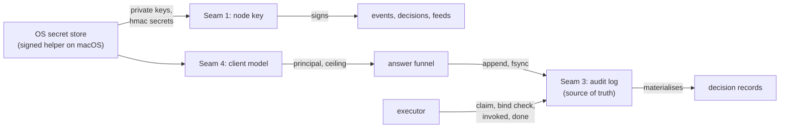

# Haystack seams: designs for P1 to P3

Four of the five seams `/hitch/v1` needs from haystack-kernel, designed before any route is written. Seam 2 (the clock) is sample-client's. Grounded in `claude-extended-v2` at `39fbe4a6`; paths are relative to `haystack-kernel/daemon/`. Companion to [HAYSTACK-ADAPTER.md](HAYSTACK-ADAPTER.md). Line references are spot-checked; re-verify before building on one.

> [!WARNING]
> **Hard to undo, in one list.** These are fixed once a client pairs or a decision is stored:
> - the node key's `kid` format and the rotation statement (seam 1)
> - the bind formula and the audit line format with its hash chain (seam 3)
> - the `cid` format and the rule that v2 mod pairings never become person-clients (seam 4)
>
> Everything else can change behind the wire.

## Seam 1: the node key

**What exists.** The only Ed25519 key in the daemon is the hub device key. It is made in `join()` (`kernel/hub/link.mjs:2308`), stored only after the hub accepts it (`:2424`, service `claude-watchtower-arc`), loaded by `privateKey()` (`:664`) and deleted in `leave()` (`:2545`). It exists only after a hub join. Nothing rotates (the hub key changes only on a fresh join). `aid` (`proto/aid.mjs:90`) is a hash of the device name and root, not a key.

**Design.**

| Topic | Decision |
|---|---|
| Separate from the hub key | **Yes.** Hitch needs a key with no hub join. The hub pins its key at enroll (`link.mjs:2341`), so sharing it would make every Hitch rotation a hub re-enroll, and a hub `leave()` would break every paired client. At P8 the two are bound by a cross-signature `{purpose:"hitch-hub-bind", aid, node:{kid,x}, hub:{device,pub}}` signed by both keys, so the relay can prove it is one machine |
| Generation | At daemon start, before the `/hitch/v1` listener opens: `generateKeyPairSync('ed25519')`. Not lazily, because discovery must always answer with the key |
| `kid` | **`node:<aid>:<fp>`**, where `fp` = the first 8 hex chars of sha256(raw `x`). A rotation then changes `kid` while `aid` stays the same. In SPEC, the schemas and the kit since this commit (checked by `discovery` and `envelopes`) |
| Private key | PKCS#8 DER, base64, in the OS store: service `claude-extended-hitch`, account `node-key-<fp>`. On macOS it goes **through the signed helper** (`helperStore`, `platform.mjs:549`). That gives a helper-only ACL (`SecAccessCreate([self])`), the planted-item refusal (`secretPins`, `:499`) and the CDHash pin (`codesignLook` `:417`, `helperPin` `:428`). Linux uses `secret-tool`; Windows uses Credential Manager (the key is far below the 800-char chunk limit) |
| Public part | `state.hitch.nodeKeys = [{kid, x, created, state: active\|retiring\|retired, rotation?}]` in a new `hitch` state namespace (`kernel/state.mjs:20`). It holds public data only |
| In memory | Loaded once at start into a non-exported `KeyObject` and kept for the process's life. Every event is signed, so a helper round trip per signature is not an option. This is the same accepted limit as the hub key: a process running as Tyler's user can read daemon memory |
| No usable store | **Hitch stays off** and `/.well-known/hitch` returns `503 {code:"gone", message:"no secret store"}`. Never fall back to an in-memory key, the way the schedule key does (`kernel/services/schedule.mjs:69-89`): clients pin the key, so a key that changes at every restart would break every pairing |
| Tests | Reuse the existing `SECRETS_FILE` JSON store knob (`platform.mjs:306`); no new knob. The adapter sets it in `setup()` |

**Rotation.** It is a local decision (`kernel.settings.confirm@1`, with presence).
1. Make the new key. The old key signs `{purpose:"hitch-node-key-rotate", aid, old:{kid,x}, new:{kid,x}, at}`.
2. `/.well-known/hitch` serves the new `nodeKey` plus `previous: [{kid, x, statement}]`. The chain is kept in state for good; it is a few hundred bytes per rotation.
3. A client holding a pinned old key checks the statement against that key and re-pins. While `retiring` (30 days), the node also accepts **sockhello** under the old key. From the first rotation on, every event is signed with the new key.
4. **A suspected compromise is not a rotation.** A statement from a stolen key proves nothing. That path is revoke-all, a fresh key, and every client paired again.

**Failure modes.** A locked keychain at start means Hitch is off and the status says why; it retries on unlock, like `{locked:true}` today (`link.mjs:664`). A missing key while `state.hitch.nodeKeys` has an active entry is treated as tampering: no new key is made silently, and Tyler is told to re-pair.

## Seam 3: the durable decision store

**What exists.** Gates become inbox items with actions (`kernel/inbox-feeds.mjs:164`). Presses go through `webAction` (`kernel/services/actions.mjs:26`) into `state.actions`, which keeps only its last 200 entries (`:243`). The "binding" is a 32-bit FNV over display text (`contentSig`, `inbox.mjs:910`). The only real bind is for sends: `bindingOf` (`kernel/sendbind.mjs:22`) gets the connector driver's `bindSend` output (Teams `{body, path}`; email `{mail, to[], subject, body|htmlSha}`; GitHub `{github, body, path}`). `state.json` is rewritten whole on every save (`kernel/state.mjs:228`), with tmp + `fsync` + rename (`:210`) but no directory fsync.

**Why not `state.json`.** Decisions and their audit are never compacted (SPEC Audit), and `state.json` is rewritten whole on every 250 ms debounced save (`kernel/services/state.mjs:359`). Permanent records there would make every save O(all decisions ever).

**Layout** (`<stateDir>/hitch/`):

| Path | What | Write rule |
|---|---|---|
| `audit/<yyyy-mm>.jsonl` | **The source of truth.** One line per event (request, edit, answer, action and resolve events) | append, then `fsync` the file; `fsync` the directory when a month file is created |
| `decisions/<id>.json` | the current record, materialised from the audit | tmp + `fsync` + rename + **directory `fsync`**. It can be rebuilt, so losing it is never fatal |
| `content/<sha256>` | large bodies served by `ref` | write once; erasing it leaves a tombstone `{erased, at, by}` while the hash stays in the audit |
| `index.json` | open decision ids and the seq high-water mark | rebuilt at boot if missing or older than the audit |

**Audit line** (normative inside Haystack, not on the wire):
`{n, at, decision, event, by, rev?, verb?, tier?, presence?, bindHash?, shownHash?, transport?, action?, outcome?, prev}`. Here `n` is a per-node monotonic counter and `prev` is the sha256 of the previous line's JCS. The chain is **tamper-evident, not tamper-proof**: an agent running as the same user can rewrite the file, but not without breaking the chain from that point on. A boot check verifies the chain from the last checkpoint. A break raises a `kernel.lan.access@1`-style tripwire item.

**Order on an answer.** Validate the answer in the funnel, compare `rev` under a per-decision mutex (CAS), append `answered` and `fsync`, update the record, then reply 200. **An answer counts as accepted only once its line is durable.** On a crash after the append but before the record write, boot replays the audit tail into the record.

**Bind.** `bindHash = sha256(JCS({kind, args}))` over **the exact bound args**, never the display text.
- For sends, `args` holds the driver's `bindSend` output, so the bind covers the same bytes the connector will send.
- The executor recomputes `bindingOf` from the current draft when it claims, and compares hashes. This replaces `sendFits`' equality check with a cryptographic one.
- For `herdr-teams.*`, the requester's rule-42 hash is taken as the bind (SPEC Decisions, step 1).
- `args` are never served. Large values go to `content/` and the record holds the ref.

**rev.** Starts at 1. It goes up on any change to `args`, `title`, `summary`, `effect` or `preview`, and on every state change. An answer naming an old `rev` gets `stale`.

**Retention.** Decision records and the audit are permanent. Month files older than 12 months are gzipped into `audit/archive/` (`node:zlib`, stdlib); the chain continues across the move. Text is erased through `content/` tombstones, never by editing audit lines. Rough size: 100 decisions a day × 5 events × ~600 bytes ≈ 110 MB a year before gzip.

**Rejected.**
- `node:sqlite`. It would give transactions for free, but the daemon ships its own runtime (`noderuntime.mjs`), and binding a permanent store to a still-maturing built-in is the wrong risk for P3. Revisit once there is load.
- A record-only store, with no log. Then the audit is whatever the record kept, and a crash mid-answer loses the evidence.

**Migration.** During the overlap, gates keep writing inbox items. `inbox-compat.mjs` also requests a decision with `kind` from `kernel/kinds.mjs` and `args` from the item's action. Both routes answer through the one funnel (SPEC Mixed versions). Pending v2 items are copied into the store at P7.

## Seam 4: the client model

**What exists.** There are 13 credential kinds, with six different revoke paths:

| v2 kind | Where | Fate in Hitch |
|---|---|---|
| Hello token `x-cx-token` (`kernel/registry.mjs:333`, in memory) | mod, or mod + `sessionId` (`:445`) | **Kept** as the `mod:<id>` principal. A hello made with a `sessionId` also acts as `session:<sid>` for messages and event filtering; no new credential is needed |
| Mod pairing, signed or bearer (`kernel/pairing.mjs:122`, first-party only, `:186`) | `state.pairings`, under the `kernel` namespace | **Frozen at P3, deleted at P7. Never migrated to a client.** These are mods acting as the person, which Hitch refuses (`not_a_client`). Their read uses map onto mod scopes |
| Dashboard cookie session, key link | `state.web.sessions`, `state.web.token` | retired at P7; the reference client replaces them |
| Menu bar key (`kernel/services/menubar.mjs:90`) | `state.web.menubar` | retired at P7 (`410 gone: pair a Hitch client`) |
| LAN phone cookie (`lan/sessions.mjs:54`) and passkeys (`lan/webauthn.mjs:396`) | `state.lan.sessions`; passkeys in the OS store `claude-watchtower-lan` | **Upgrade path:** a signed-in LAN session may start a Hitch pairing with its passkey offered as the presence key (`webauthn` suite: the credential id, public key, `rpId` and origins come from the passkey record). Approval is still a local decision |
| Test user token (`kernel/user.mjs:32,52`) | test folders only | becomes the adapter's `mintClient` |
| TCP API key `x-watchtower-key` (`kernel/services/tcp.mjs:28-61`) | `api.json` | **stays as a transport guard** for the Windows loopback port (checked before sockhello); it is not a principal |
| Send tickets (`kernel/tickets.mjs`) | memory | kept, minted at executor claim |

**The record** (`state.hitch.clients[cid]`, in the `hitch` namespace and covered by `SECURITY_KEYS` per-record MACs, `kernel/state.mjs:84`). This is the public `hitch.client@1` plus:

| Field | Notes |
|---|---|
| `cid` | `c_` + 10 base32 characters, random. **Hard to undo:** clients store it |
| `suite`, `pub` | Ed25519 `x`, or P-256 `{x, y}` |
| hmac secret | **never in the state file** (it is readable by any process running as Tyler); stored in the OS store under `claude-extended-hitch` / `client-<cid>` |
| `presence[]` | `{kid, suite, pub, origins?, rpId?, signCount}`, fixed at pairing as bound in the pair decision |
| `ceiling`, `privacy`, `scopes` | First client: local and text. Later clients: decide and meta (SPEC Starting ceilings) |
| `principalKind` | `client` or `app`. An app (herdr-app, the herdr runner, the pairview daemon) uses the same record with scopes `publish+request+execute:<owner>` and **no ceiling**, so it can never answer |
| `state`, `paired`, `lastSeen` | `revoked` keeps the record (SPEC Audit); its secret is deleted |

**Effective tier**, per request: min(client ceiling, suite cap (hmac: decide), transport clamp). The clamp is loopback or socket up to local; LAN up to confirm, with confirm needing presence in place of today's `takeFresh` (`lan/tiers.mjs:183`); relay up to confirm.

**One revoke.** `revokePrincipal(id)` dispatches on the id: `c_…` (client or app) marks it revoked and deletes its secret. During the overlap it also calls the v2 paths: `pairing.revoke`, `lanSessions.signOut`, `passkeys.remove` and `signOutMenubar`. Each call writes an audit line. **Revoke-all** revokes every person credential of every kind. It does not revoke hello tokens (agents are not persons) and does not rotate the node key.

## Seam 5: the executor call log

**What exists.** `state.actions[]` keeps `claimedBy`, `claimedAt`, `status` and `result` (`kernel/routes/actions.mjs:36-66`), with a 10-minute lease (`kernel/services/tick.mjs:81`) and only the last 200 actions. A late `done` after the lease is still accepted (`kernel/routes/actions.mjs:58`). Nothing records how many times an executor ran.

**Design: executor events are audit lines (seam 3)**, so one chain covers the whole life of a decision.

| Event | Written when | Fields |
|---|---|---|
| `action.queued` | an option is chosen | `action`, `verb` |
| `action.claimed` | an executor takes the lease | `by` (an in-process executor, or a kernel-minted executor credential; **never a hello token**), `leaseUntil` |
| `action.bind` | the executor re-checks the bind at claim | `ok`, `bindHash` recomputed. On a mismatch the outcome is `failed` and nothing runs |
| `action.invoked` | **just before** the side effect | `attempt`. This is what the adapter's `executorCalls(id)` counts |
| `action.done` | the executor reports | `ok`, a `result` digest, `late` (true when the lease had lapsed) |
| `action.lease-expired` | the tick finds a lapsed lease | lets another claimer take it |

- **A late `done` is recorded, not dropped.** The side effect happened, so the truth matters more than the lease. If a second claimer already invoked, the decision resolves `failed`, with both invocations in the log, and Tyler sees a duplicate-run item. That is honest rather than silent.
- **No retry into a new outcome.** A `failed` outcome stays failed; running it again takes a new decision (SPEC Decisions, step 7).
- `action.invoked` is written and fsynced **before** the side effect. A crash between the two then shows as invoked-without-done, which is the case a person must look at, never a silent re-run.

## Open questions

1. ~~Kid format~~: decided and landed (`node:<aid>:<fp>`).
2. **Mod pairings never become clients.** This follows SPEC Principle 3, but some first-party mods may rely on acting as the person today. Their read paths need an inventory before P3 freezes them.
3. **Audit size and archive at 12 months.** These are estimates; check against a week of real decision counts once P3 runs.
4. **The duplicate-run policy** (a late `done` while another claimer invoked): resolve `failed` and raise an item, as above, or hold the outcome until Tyler decides?
