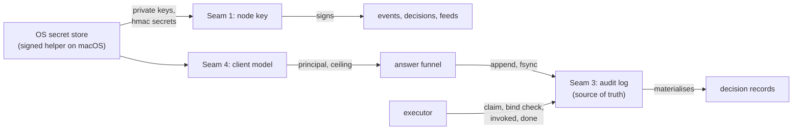

# Haystack seams: designs for P1 to P3

Four of the five seams `/hitch/v1` needs from haystack-kernel, designed before any route is written. Seam 2 (the clock) is sample-client's. Grounded in `claude-extended-v2` at `39fbe4a6`; paths are relative to `haystack-kernel/daemon/`. Companion to [HAYSTACK-ADAPTER.md](HAYSTACK-ADAPTER.md). Line references are spot-checked; re-verify before building on one.

> [!WARNING]
> **Hard to undo, in one list.** These are fixed once a client pairs or a decision is stored:
> - the node key's `kid` format and the rotation statement (seam 1)
> - the bind formula and the audit line format with its hash chain (seam 3)
> - the `cid` format and the rule that v2 mod pairings never become person-clients (seam 4)
>
> Everything else can change behind the wire.

## Seam 1: the node key

**What exists.** The only Ed25519 key in the daemon is the hub device key. It is made in `join()` (`kernel/hub/link.mjs:2308`), stored only after the hub accepts it (`:2424`, service `claude-watchtower-arc`), loaded by `privateKey()` (`:664`) and deleted in `leave()` (`:2545`). It exists only after a hub join. Nothing rotates (the hub key changes only on a fresh join). `aid` (`proto/aid.mjs:90`) is a hash of the device name and root, not a key.

**Design.**

| Topic | Decision |
|---|---|
| Separate from the hub key | **Yes.** Hitch needs a key with no hub join. The hub pins its key at enroll (`link.mjs:2341`), so sharing it would make every Hitch rotation a hub re-enroll, and a hub `leave()` would break every paired client. At P8 the two are bound by a cross-signature `{purpose:"hitch-hub-bind", aid, node:{kid,x}, hub:{device,pub}}` signed by both keys, so the relay can prove it is one machine |
| Generation | At daemon start, before the `/hitch/v1` listener opens: `generateKeyPairSync('ed25519')`. Not lazily, because discovery must always answer with the key |
| `kid` | **`node:<aid>:<fp>`**, where `fp` = the first 8 hex chars of sha256(raw `x`). A rotation then changes `kid` while `aid` stays the same. In SPEC, the schemas and the kit since this commit (checked by `discovery` and `envelopes`) |
| Private key | PKCS#8 DER, base64, in the OS store: service `claude-extended-hitch`, account `node-key-<fp>`. On macOS it goes **through the signed helper** (`helperStore`, `platform.mjs:549`). That gives a helper-only ACL (`SecAccessCreate([self])`), the planted-item refusal (`secretPins`, `:499`) and the CDHash pin (`codesignLook` `:417`, `helperPin` `:428`). Linux uses `secret-tool`; Windows uses Credential Manager (the key is far below the 800-char chunk limit) |
| Public part | `state.hitch.nodeKeys = [{kid, x, created, state: active\|retiring\|retired, rotation?}]` in a new `hitch` state namespace (`kernel/state.mjs:20`). It holds public data only |
| In memory | Loaded once at start into a non-exported `KeyObject` and kept for the process's life. Every event is signed, so a helper round trip per signature is not an option. This is the same accepted limit as the hub key: a process running as Tyler's user can read daemon memory |
| No usable store | **Hitch stays off** and `/.well-known/hitch` returns `503 {code:"gone", message:"no secret store"}`. Never fall back to an in-memory key, the way the schedule key does (`kernel/services/schedule.mjs:69-89`): clients pin the key, so a key that changes at every restart would break every pairing |
| Tests | Reuse the existing `SECRETS_FILE` JSON store knob (`platform.mjs:306`); no new knob. The adapter sets it in `setup()` |

**Rotation.** It is a local decision (`kernel.settings.confirm@1`, with presence).
1. Make the new key. The old key signs `{purpose:"hitch-node-key-rotate", aid, old:{kid,x}, new:{kid,x}, at}`.
2. `/.well-known/hitch` serves the new `nodeKey` plus `previous: [{kid, x, statement}]`. The chain is kept in state for good; it is a few hundred bytes per rotation.
3. A client holding a pinned old key checks the statement against that key and re-pins. While `retiring` (30 days), the node also accepts **sockhello** under the old key. From the first rotation on, every event is signed with the new key.
4. **A suspected compromise is not a rotation.** A statement from a stolen key proves nothing. That path is revoke-all, a fresh key, and every client paired again.

**Failure modes.** A locked keychain at start means Hitch is off and the status says why; it retries on unlock, like `{locked:true}` today (`link.mjs:664`). A missing key while `state.hitch.nodeKeys` has an active entry is treated as tampering: no new key is made silently, and Tyler is told to re-pair.

## Seam 3: the durable decision store

**What exists.** Gates become inbox items with actions (`kernel/inbox-feeds.mjs:164`). Presses go through `webAction` (`kernel/services/actions.mjs:26`) into `state.actions`, which keeps only its last 200 entries (`:243`). The "binding" is a 32-bit FNV over display text (`contentSig`, `inbox.mjs:910`). The only real bind is for sends: `bindingOf` (`kernel/sendbind.mjs:22`) gets the connector driver's `bindSend` output (Teams `{body, path}`; email `{mail, to[], subject, body|htmlSha}`; GitHub `{github, body, path}`). `state.json` is rewritten whole on every save (`kernel/state.mjs:228`), with tmp + `fsync` + rename (`:210`) but no directory fsync.

**Why not `state.json`.** Decisions and their audit are never compacted (SPEC Audit), and `state.json` is rewritten whole on every 250 ms debounced save (`kernel/services/state.mjs:359`). Permanent records there would make every save O(all decisions ever).

**Layout** (`<stateDir>/hitch/`):

| Path | What | Write rule |
|---|---|---|
| `audit/<yyyy-mm>.jsonl` | **The source of truth.** One line per event (request, edit, answer, action and resolve events) | append, then `fsync` the file; `fsync` the directory when a month file is created |
| `decisions/<id>.json` | the current record, materialised from the audit | tmp + `fsync` + rename + **directory `fsync`**. It can be rebuilt, so losing it is never fatal |
| `content/<sha256>` | large bodies served by `ref` | write once; erasing it leaves a tombstone `{erased, at, by}` while the hash stays in the audit |
| `index.json` | open decision ids and the seq high-water mark | rebuilt at boot if missing or older than the audit |

**Audit line** (normative inside Haystack, not on the wire):
`{n, at, decision, event, by, rev?, verb?, tier?, presence?, bindHash?, shownHash?, transport?, action?, outcome?, body?, prev}`. Here `n` is a per-node monotonic counter and `prev` is the sha256 of the previous line's JCS. The chain is **tamper-evident, not tamper-proof**: an agent running as the same user can rewrite the file, but not without breaking the chain from that point on. A boot check verifies the chain from the last checkpoint. A break raises a `kernel.lan.access@1`-style tripwire item.

- **Head anchor** (found by sample-client in P3). A chain cannot detect an edit to, or a truncation of, its **last** lines, because nothing chains onto them yet. So after each append the node writes `state.hitch.auditHead = {n, hash, mac}`, where `mac` = HMAC-SHA256 over JCS({n, hash}) under a **dedicated** key `claude-extended-hitch` / `audit-anchor` in the OS store (through the signed helper on macOS). It is not the schedule approval key: one key, one job. At boot the audit's last line must reach the anchored `{n, hash}` with a valid chain. The anchor may lag by the lines appended just before a crash, which must chain from it. Anything else (a shorter audit, a different hash at `n`, or a bad `mac`) is a tripwire.
- **`body` on `requested` and `edited`** makes the audit enough to rebuild every record. It carries the public record plus **`argsRef`** (`sha256:` of JCS(args)), never the args inline. The args live in `content/`. Bound args can hold text-class content (a draft body), and an inline copy in a hash-chained line could never be erased without breaking the chain. Erasing args tombstones `content/<argsRef>`; the chain stays intact, and a rebuild yields the record with `args` marked erased. `GET …/audit` strips `body` either way.

**Order on an answer.** Validate the answer in the funnel, compare `rev` under a per-decision mutex (CAS), append `answered` and `fsync`, update the record, then reply 200. **An answer counts as accepted only once its line is durable.** On a crash after the append but before the record write, boot replays the audit tail into the record.

**Bind.** `bindHash = sha256(JCS({kind, args}))` over **the exact bound args**, never the display text.
- For sends, `args` holds the driver's `bindSend` output, so the bind covers the same bytes the connector will send.
- The executor recomputes `bindingOf` from the current draft when it claims, and compares hashes. This replaces `sendFits`' equality check with a cryptographic one.
- For `herdr-teams.*`, the requester's rule-42 hash is taken as the bind (SPEC Decisions, step 1).
- `args` are never served. Large values go to `content/` and the record holds the ref.

**rev.** Starts at 1. It goes up on any change to `args`, `title`, `summary`, `effect` or `preview`, and on every state change. An answer naming an old `rev` gets `stale`.

**Retention.** Decision records and the audit are permanent. Month files older than 12 months are gzipped into `audit/archive/` (`node:zlib`, stdlib); the chain continues across the move. Text is erased through `content/` tombstones, never by editing audit lines. Rough size: 100 decisions a day × 5 events × ~600 bytes ≈ 110 MB a year before gzip.

**Rejected.**
- `node:sqlite`. It would give transactions for free, but the daemon ships its own runtime (`noderuntime.mjs`), and binding a permanent store to a still-maturing built-in is the wrong risk for P3. Revisit once there is load.
- A record-only store, with no log. Then the audit is whatever the record kept, and a crash mid-answer loses the evidence.

**Migration.** During the overlap, gates keep writing inbox items. `inbox-compat.mjs` also requests a decision with `kind` from `kernel/kinds.mjs` and `args` from the item's action. Both routes answer through the one funnel (SPEC Mixed versions). Pending v2 items are copied into the store at P7.

## Seam 4: the client model

**What exists.** There are 13 credential kinds, with six different revoke paths:

| v2 kind | Where | Fate in Hitch |
|---|---|---|
| Hello token `x-cx-token` (`kernel/registry.mjs:333`, in memory) | mod, or mod + `sessionId` (`:445`) | **Kept** as the `mod:<id>` principal. A hello made with a `sessionId` also acts as `session:<sid>` for messages and event filtering; no new credential is needed |
| Mod pairing, signed or bearer (`kernel/pairing.mjs:122`, first-party only, `:186`) | `state.pairings`, under the `kernel` namespace | **Frozen at P3, deleted at P7. Never migrated to a client.** These are mods acting as the person, which Hitch refuses (`not_a_client`). Their read uses map onto mod scopes |
| Dashboard cookie session, key link | `state.web.sessions`, `state.web.token` | retired at P7; the reference client replaces them |
| Menu bar key (`kernel/services/menubar.mjs:90`) | `state.web.menubar` | retired at P7 (`410 gone: pair a Hitch client`) |
| LAN phone cookie (`lan/sessions.mjs:54`) and passkeys (`lan/webauthn.mjs:396`) | `state.lan.sessions`; passkeys in the OS store `claude-watchtower-lan` | **Upgrade path:** a signed-in LAN session may start a Hitch pairing with its passkey offered as the presence key (`webauthn` suite: the credential id, public key, `rpId` and origins come from the passkey record). Approval is still a local decision |
| Test user token (`kernel/user.mjs:32,52`) | test folders only | becomes the adapter's `mintClient` |
| TCP API key `x-watchtower-key` (`kernel/services/tcp.mjs:28-61`) | `api.json` | **stays as a transport guard** for the Windows loopback port (checked before sockhello); it is not a principal |
| Send tickets (`kernel/tickets.mjs`) | memory | kept, minted at executor claim |

**The record** (`state.hitch.clients[cid]`, in the `hitch` namespace and covered by `SECURITY_KEYS` per-record MACs, `kernel/state.mjs:84`). This is the public `hitch.client@1` plus:

| Field | Notes |
|---|---|
| `cid` | `c_` + 10 base32 characters, random. **Hard to undo:** clients store it |
| `suite`, `pub` | Ed25519 `x`, or P-256 `{x, y}` |
| hmac secret | **never in the state file** (it is readable by any process running as Tyler); stored in the OS store under `claude-extended-hitch` / `client-<cid>` |
| `presence[]` | `{kid, suite, pub, origins?, rpId?, signCount}`, fixed at pairing as bound in the pair decision |
| `ceiling`, `privacy`, `scopes` | First client: local and text. Later clients: decide and meta (SPEC Starting ceilings) |
| `principalKind` | `client` or `app`. An app (herdr-app, the herdr runner, the pairview daemon) uses the same record with scopes `publish+request+execute:<owner>` and **no ceiling**, so it can never answer |
| `state`, `paired`, `lastSeen` | `revoked` keeps the record (SPEC Audit); its secret is deleted |

**Effective tier**, per request: min(client ceiling, suite cap (hmac: decide), transport clamp). The clamp is loopback or socket up to local; LAN up to confirm, with confirm needing presence in place of today's `takeFresh` (`lan/tiers.mjs:183`); relay up to confirm.

**One revoke.** `revokePrincipal(id)` dispatches on the id: `c_…` (client or app) marks it revoked and deletes its secret. During the overlap it also calls the v2 paths: `pairing.revoke`, `lanSessions.signOut`, `passkeys.remove` and `signOutMenubar`. Each call writes an audit line. **Revoke-all** revokes every person credential of every kind. It does not revoke hello tokens (agents are not persons) and does not rotate the node key.

## Seam 5: the executor call log

**What exists.** `state.actions[]` keeps `claimedBy`, `claimedAt`, `status` and `result` (`kernel/routes/actions.mjs:36-66`), with a 10-minute lease (`kernel/services/tick.mjs:81`) and only the last 200 actions. A late `done` after the lease is still accepted (`kernel/routes/actions.mjs:58`). Nothing records how many times an executor ran.

**Design: executor events are audit lines (seam 3)**, so one chain covers the whole life of a decision.

| Event | Written when | Fields |
|---|---|---|
| `action.queued` | an option is chosen | `action`, `verb` |
| `action.claimed` | an executor takes the lease | `by` (an in-process executor, or a kernel-minted executor credential; **never a hello token**), `leaseUntil` |
| `action.bind` | the executor re-checks the bind at claim | `ok`, `bindHash` recomputed. On a mismatch the outcome is `failed` and nothing runs |
| `action.invoked` | **just before** the side effect | `attempt`. This is what the adapter's `executorCalls(id)` counts |
| `action.done` | the executor reports | `ok`, a `result` digest, `late` (true when the lease had lapsed) |
| `action.lease-expired` | the tick finds a lapsed lease | after `invoked`: the outcome is `uncertain` and `hitch.retry@1` is raised; before `invoked`: the action returns to `queued` |

- **Never re-run a side effect automatically** (lead decision). When a lease ends after `action.invoked` with no `action.done`, the decision resolves **`uncertain`** and the node raises a **`hitch.retry@1`** decision. It shows the evidence (when the action was invoked, when the lease ended, runs so far), offers `retry` at the tier first chosen with the original's safety, and offers "Leave it". A lapsed lease is never handed to another claimer. A `done` that arrives after the lease is recorded as `action.done {late: true}` against the `uncertain` decision, for Tyler to see; it does not change the outcome. Checked by `uncertain-never-reruns` and `uncertain-leave-it`.
- **No retry into a new outcome.** A `failed` outcome stays failed; running it again takes a new decision (SPEC Decisions, step 7).
- `action.invoked` is written and fsynced **before** the side effect. A crash between the two then shows as invoked-without-done, which is the case a person must look at, never a silent re-run.

## Inventory: where v2 acts as the person, and what replaces each at P3

Every path in v2 where a mod, a session, a hello token or a paired session's signature does something that needs the person. Each row names the Hitch decision kind (or retirement) that replaces it at P3, when mod pairings are frozen. Read from v2 at `39fbe4a6`; the agent-alone rows were spot-checked. **P3 exit check: every row's replacement exists and renders in the reference client before its v2 path is switched off** (SPEC P5: "each removal gated on its decision kind existing").

How v2 does it today:
- `sdk/user.ts:152` `userHeaders` signs **every** call from a paired session, except non-typed `asOrigin` commands and calls made while `vouchHeld` is set.
- The kernel takes the person via `registry.isUser` (`kernel/registry.mjs:650`), which also still accepts old bearer pairings.
- Dashboard presses run as the kernel's own calls through `webAction` (`kernel/services/actions.mjs:27`).

In Hitch, a typed slash command in a session is **not** an answer. It points at the decision, and a paired client answers it; the CLI with Touch ID counts as one.

### Kernel (Dashboard, notifications, menu bar: today kernel-own)

| # | Acts as the person | Today | P3 replacement | Tier |
|---|---|---|---|---|
| K1 | Merge a PR | `actions.mjs:190` | `watch.merge@1` | confirm (safety merge) |
| K2 | Approve or reject a deployment run | `actions.mjs:187`, `ext/watchtower/ci.mjs:111,130` | `watch.deploy@1` (reject = decline) | confirm / narrow |
| K3 | PR ready or draft | `actions.mjs:204` | `watch.prready@1` | confirm |
| K4 | Connector sign-in; sign-out | `actions.mjs:145-170` | `kernel.connector.signin@1`; **new** `kernel.connector.signout@1` | local; decide |
| K5 | Schedule job add, update, approve, run | `actions.mjs:129-135` | `kernel.job.approve@1` (add and update options raised to local) | confirm; local |
| K6 | Agents grant, extend, expose, unblock | `actions.mjs:125` | `kernel.agents.grant@1` | local |
| K7 | Allow a mod pairing | `actions.mjs:87` | **retired**: mods never act as the person. Clients use `hitch.client.pair@1` | (local) |
| K8 | Admit a third-party mod | `actions.mjs:88` | `kernel.mod.admit@1` | local |
| K9 | Allow first-party code whose hash differs | `actions.mjs:96` | **new** `kernel.extension.allow@1` | local |
| K10 | Set the default permission mode | `actions.mjs:124`, `services/hooks.mjs:124` | `kernel.permissions.mode@1` | local |
| K11 | Apply a settings confirm | `actions.mjs:113`, `routes/settings.mjs:358` | `kernel.settings.confirm@1` | local |
| K12 | Answer a session's permission prompt or question in its pane | `actions.mjs:74`, `paneanswer.mjs` | `queue.permission@1` / `queue.question@1`; the pane is re-checked against the bind at keypress | confirm (deny narrow) |
| K13 | Release a held hub send; deliver a held incoming message; resume; move | `actions.mjs:77-85` | `kernel.hub.release@1`; **new** `kernel.hub.deliver@1` | confirm; local |
| K14 | Send feedback; file it as a GitHub issue | `actions.mjs:109` | **new** `kernel.feedback.send@1` (filing the issue is an option raised to local) | confirm (safety send) |
| K15 | Revive ended sessions | `actions.mjs:125` | **new** `kernel.session.revive@1` | confirm |
| K16 | Approve a notifier topic | `actions.mjs:120` | `hitch.client.scope@1` (SPEC: notifier topics become client scopes) | local |
| K17 | Claim a queued mod action (an outbox send gets a ticket) | `routes/actions.mjs:17-45`, `kernel/tickets.mjs` | the executor claims with a **kernel-minted credential**; a hello token never claims (seam 5) | — |
| K18 | A paired session decides pairings | `routes/registry.mjs:67` | **removed**: `not_a_client` | — |
| K19 | Hub approve or staged release with a paired signature | `routes/hub.mjs:336,345` | `kernel.hub.release@1` | confirm |

### haystack-kernel hooks (typed commands and in-session dialogs, signed as the person)

| # | Acts as the person | Today | P3 replacement | Tier |
|---|---|---|---|---|
| H1 | Schedule approve, deny, run; `/jobs` | `hooks/register.tsx:439-598` | `kernel.job.approve@1` | confirm |
| H2 | Connector sign-in; store or delete a token secret | `register.tsx:784-1594` | `kernel.connector.signin@1` / `kernel.connector.signout@1` | local; decide |
| H3 | Confirm a browser's Dashboard sign-in | `register.tsx:1687` | **retired at P7** with the Dashboard; until then `hitch.client.pair@1` | local |
| H4 | LAN on or off, new certificate, passkey; sign devices out | `register.tsx:1716-1877` | `kernel.lan.access@1`; the revoke routes | local; per the revoke rules |
| H5 | `/hub` join, move, leave, held-message decisions, grants; agents policy | `register.tsx:1886-1998` | **new** `kernel.hub.membership@1`; `kernel.hub.deliver@1`; `kernel.agents.grant@1` | local |
| H6 | Push the person's own `/config` keys | `register.tsx:734` | `kernel.settings.confirm@1` | local |
| H7 | Pick the to-do sink; install notify buttons or hookwait | `register.tsx:1403-1447` | `kernel.settings.confirm@1` | local |
| H8 | `/agents revive` | `hooks/sessions.tsx:25` | `kernel.session.revive@1` | confirm |

### Mods

| # | Mod | Acts as the person | Today | P3 replacement | Tier |
|---|---|---|---|---|---|
| W1 | watchtower | Merge from the ready dialog or a pane button | `watchtower/hooks/register.tsx:1209,1948` → `ext/watchtower/routes.mjs:379` | `watch.merge@1` | confirm |
| W2 | watchtower | Unwatch | `register.tsx:1234,1976` | it only narrows, so it stays the mod's own action; **no paired signature** | — |
| W3 | watchtower | Push its config keys | `register.tsx:1309` | `kernel.settings.confirm@1` | local |
| W4 | watchtower | Reset the retry cap ("Approve another try") | `POST /reset`, **unauthenticated**, `routes.mjs:351` | **new** `watch.retry@1`; the route takes a credential | decide |
| W5 | watchtower | A stacked PR's "land the chain as one PR" note (Haystack P5) | `watchtower/hooks/register.tsx` dialog, `daemon/inbox.mjs` merge item with no Merge | **new** item `watch.stacked@1`, offers dismiss | narrow (item verb) |
| W6 | watchtower | A review requested of the person (Haystack P5) | `register.tsx` dialog, `daemon/inbox.mjs` review item | **new** item `watch.review@1`, offers dismiss; the review itself is on its pull request | narrow (item verb) |
| O1 | outbox | Send a Teams message or PR comment, or make an Outlook draft | `outbox/hooks/register.tsx:585-6021` (`writeAuth`) | `outbox.send@1`, with the bind over the driver's `bindSend` bytes | confirm (safety send) |
| O2 | outbox | The Dashboard's queued Send | `register.tsx:4606,4797` + ticket | `outbox.send@1` → executor → ticket at claim | confirm |
| O3 | outbox | **Jira comment through the session's own Atlassian MCP** | `register.tsx:1141,1197`; the kernel never sees it, and `connector-jira/driver.mjs:84` `gateWrite` lets every write through | `outbox.send@1` through the **kernel's** Jira connector, with a real `gateWrite`. The session-MCP path is removed | confirm |
| O4 | outbox / report | Finish the Weekly Report → Outlook draft | `register.tsx:5468,5586,4079` | `report.send@1` | confirm |
| O5 | outbox | Microsoft sign-in; background token refresh writes secrets | `register.tsx:713-718,471` | `kernel.connector.signin@1`. The refresh runs as the daemon's connector executor (P6), with no person signature | local |
| O6 | outbox | Send a draft on a provider mod's channel (`provides: outbox.channel:<name>`, Haystack P5) | `outbox/hooks/register.tsx` raiseDraft, the provider's `send` rpc | **new** `outbox.provider.send@1`, `provider` bound, the draft as shown (to, subject, body, seen) | confirm (safety send) |
| P1 | parley | Approve a draft → hub send, with the person's approval signed | `parley/hooks/register.tsx:680-693,2314,2344` | `parley.send@1` | decide, confirm if it reaches out |
| P2 | parley | "Say" in the person's words; room post | `register.tsx:1101,1865,2565` | `parley.send@1` / `parley.room.post@1` | confirm |
| P3 | parley | "Approve and always allow" → hub policy grant | `register.tsx:3410,851` | `hitch.grant.issue@1`, **refused when it reaches out** (see open question 5) | local |
| P4 | parley | Deliver, discard or block a held incoming message | `register.tsx:2196,3548` | `kernel.hub.deliver@1` | local |
| P5 | parley | Create, join or go live in a room; the kill switch | `register.tsx:3493,2544,2088,1840,4726` | **new** `parley.room.admit@1`. The kill switch only narrows: no decision | local |
| F1 | forms | Submit, decline, or send through the hub | `forms/hooks/register.tsx:391-777` | `forms.submit@1` (send raised to confirm) | decide; confirm |
| D1 | director | Approve a hire → open a Terminal or revive a session | `director/hooks/register.tsx:643,667,1030,1639,2149,2228` | `director.hire@1` | confirm |
| D2 | director | **`director_approve` tool approves when the typed prompt says "approve #N"** | `register.tsx:580-606` | **removed**: words in a prompt are not consent. A client answers `director.hire@1` | confirm |
| Q1 | queue | Inbox pane decisions | `queue/hooks/register.tsx:465` | `queue.*@1` | confirm (deny narrow) |
| Q2 | queue | Answer a waiting question **as the person's words** (`asUser`) | `register.tsx:305-326,768` | `queue.question@1`, answered by a client. The `asUser` channel from the store file is removed | confirm |
| T1 | tasks | Queued nudge, discuss, bring (text typed into sessions) | `tasks/hooks/register.tsx:2654` | **retired**: Hitch never prompts (Principle 2). The person writes with `POST /messages` | — |
| T2 | tasks | An urgent to-do, an overdue wait, a to-do whose ticket finished (Haystack P5) | `tasks/hooks/register.tsx` askTask, `sdk/inbox-tasks.ts` | **new** item `tasks.todo@1`, offers done and snooze; changing the wait is a full client's | narrow (item verb) |
| R1 | report | Finish (stages in Outbox), research | `report/hooks/register.tsx:1775` | `report.send@1` | confirm |
| WI1 | wins | Sweep: a prompt sent to every agent | `wins/hooks/register.tsx:1270,1342` | **retired** (sweeps are gone) | — |
| PB1 | playbook | Keep or keepRepo (its own approval key) | `playbook/hooks/register.tsx:917,960` | `playbook.entry@1` | decide |
| U1 | updates | Reload every session's mods with a paired signature | `updates/hooks/register.tsx:309` | kernel maintenance with **no person signature**; changed code goes through `kernel.extension.allow@1` | — |

### What an agent can trigger alone today, and what closes it

| # | Hole (verified) | Closed at P3 by |
|---|---|---|
| A1 | **Queue reply forgery.** An agent writes a reply signal into the queue store file, and the target session submits it as the person's words (`queue/hooks/register.tsx:326`) | **Hot-fixed early on v2 (2026-11-24).** P3 still owns `queue.question@1`, answered only by a paired client, and the deletion of the `asUser` path |
| A2 | **`POST /reset` with no credential** clears a watch's retry cap (`ext/watchtower/routes.mjs:351`) | `watch.retry@1`; the route takes a credential |
| A3 | **A forged first-party hello** passes poll, claim and done for that mod's queued actions (`kernel/routes/actions.mjs:18`) | **Decided (lead, 2026-11-24): closed at P3 on the decision side.** A Hitch-approved action carries a kernel-minted claim ticket bound to that action; only it claims, and outcomes come from the executor log (seam 5). v2's Dashboard queue keeps hello-token claims until P6 |
| A4 | **Tokenless legacy fallbacks**: `olderCaller` (`routes/actions.mjs:19`), `mayHubShim`, `mayConnect`, `/inbox/act` when absent | **Decided:** `/hitch/v1` refuses tokenless callers from P1. `olderCaller`, `mayHubShim` and `mayConnect` go at P7, with a Health counter of their hits so removal is measured, not guessed |
| A5 | **Bearer pairings** still accepted as `x-cx-user` (`registry.mjs:650`); capturable by a socket relay | **Decided:** new bearer pair asks are refused from P3; never accepted on `/hitch/v1`; keyed mod pairings are frozen at P7 |
| A6 | **Jira writes** bypass the kernel (O3), and `connector-jira` `gateWrite` allows everything (`driver.mjs:84`) | **Hot-fixed early on v2 (2026-11-24).** P3 still owns `outbox.send@1` through the kernel connector, with a real `gateWrite` |
| A7 | **Parley trusted pairs** send with no click under "always allow" | **Decided:** a send that reaches out is a safety `send` at confirm (catalogue `reachesOut`), so always-allow covers only sessions on this machine. Checked by `reaches-out-is-a-send` |
| A8 | **Wins** are logged without the person's confirmation (`wins/hooks/register.tsx:930`, off by default) | **Accepted limit (Tyler, 2026-11-24):** wins need no confirmation by default. Agents log them as today; review and discard are optional in a client (`wins.confirm@1`) |
| A9 | **Paired sessions sign from timers** (`outbox:471` refresh, `updates:309` reload) | paired signatures are gone; background work runs as daemon executors |

### Kinds this adds to the catalogue

`kernel.connector.signout@1` (decide), `kernel.extension.allow@1` (local), `kernel.hub.deliver@1` (local), `kernel.hub.membership@1` (local), `kernel.feedback.send@1` (confirm, safety send), `kernel.session.revive@1` (confirm), `watch.retry@1` (decide), `parley.room.admit@1` (local). They are in `catalogue.json` now. Their arg schemas are owed by the Haystack seat that builds each one, and `hitch-catalog-check` stays red until they exist, which is the gate working.

## Open questions

1. ~~Kid format~~: decided and landed (`node:<aid>:<fp>`).
2. ~~Mod pairings never become clients~~: decided. The inventory above lists every path that relies on them and what replaces it.
3. **Audit size and archive at 12 months.** These are estimates; check against a week of real decision counts once P3 runs.
4. ~~Duplicate-run policy~~: decided. Nothing re-runs automatically; the outcome is `uncertain` and a `hitch.retry@1` decision is raised.
5. ~~Parley sends that reach out~~: decided. Always a safety `send` at confirm.
6. ~~Wins confirmation by default~~: decided. No confirmation by default; A8 is an accepted limit.
